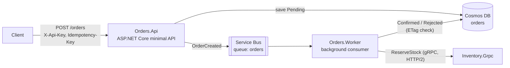

# Order Processing Microservices

[](https://github.com/Rogenis/order-processing-microservices/actions/workflows/ci.yml)

Event-driven order processing on **.NET 10**, **Azure Cosmos DB**, **Azure Service Bus** and **gRPC**, with idempotent APIs, at-least-once messaging and failure handling verified end to end.

The whole system runs locally with one command, using the official Azure emulators. No Azure account needed.

```
docker compose up --build
./scripts/demo.sh
```

## Architecture



1. **Orders.Api** validates the order, stores it as `Pending` in Cosmos DB and publishes `OrderCreated` to Service Bus. It answers `201` right away; processing is asynchronous.
2. **Orders.Worker** consumes the queue, calls **Inventory.Grpc** to reserve stock, and moves the order to `Confirmed` or `Rejected` (with the reason).
3. **Inventory.Grpc** reserves all lines or none, and is idempotent per order.

| Project | Responsibility |
|---|---|
| `Orders.Domain` | `Order` aggregate, status rules, validation, ports (`IOrderRepository`, `IOrderEventPublisher`) |
| `Orders.Infrastructure` | Cosmos DB repository, Service Bus publisher, message serialization |
| `Orders.Api` | HTTP endpoints, API-key auth, idempotency |
| `Orders.Worker` | Queue consumer, retry policy, gRPC client |
| `Inventory.Grpc` | Stock reservation service (`protos/inventory.proto`) |

## Design decisions

**Idempotent order creation.** With an `Idempotency-Key` header, the order id is derived from `(customerId, key)` with SHA-256. A retried request lands on the same Cosmos document: the API returns `200` with the existing order instead of creating a duplicate. Reusing a key with a different payload returns `409`.

**Saved but not published.** Writing to Cosmos and publishing to Service Bus are two operations that cannot share a transaction. If publishing fails, the API returns `503` and asks the client to retry with the same key; the replay republishes the event for orders still `Pending`. A transactional outbox (Cosmos change feed) would remove this window entirely. It is the first item under *Next steps*.

**At-least-once delivery, idempotent consumer.** Messages can arrive more than once. The worker skips orders that are no longer `Pending`, inventory reservations are keyed by order id, and the queue has duplicate detection on `MessageId`.

**Optimistic concurrency.** Order updates use Cosmos `IfMatchEtag`. If two worker instances race on the same order, the loser re-reads it and treats it as already processed.

**Failure handling, tested by stopping services.**
- Short outages: the gRPC client retries `Unavailable` 3 times with backoff (safe because `ReserveStock` is idempotent).
- Longer outages: the worker schedules a copy of the message with exponential delay (2 s, 4 s, 8 s… up to 5 min, 8 attempts) instead of abandoning it. Abandoning immediately would burn every delivery attempt in seconds. In a manual test, the inventory service was down for 20 s: the order was retried 4 times and confirmed once the service came back.
- Messages that can never succeed (invalid body, unknown order) go straight to the dead-letter queue with a reason.

**Partition key `/id`.** Every read and write in the processing path is a point operation by order id, which is the cheapest Cosmos operation. Listing by customer is a cross-partition query; at scale, a second container partitioned by `/customerId` (fed by the change feed) would serve that read model.

**Security.** API key compared in constant time (`CryptographicOperations.FixedTimeEquals`), options validated at startup (the service refuses to start without a key), problem-details responses, containers running as non-root.

## Run it

Requirements: Docker. The first start downloads the emulators (Cosmos DB, Service Bus and SQL Server, used internally by the Service Bus emulator) and takes a few minutes.

```bash
docker compose up --build -d
./scripts/demo.sh
```

The demo creates one order that is confirmed, one rejected for insufficient stock, and repeats a request with the same `Idempotency-Key`:

```
== Status final
{"id":"8613…","customerId":"maria","status":"Confirmed", …}
{"id":"8e2b…","customerId":"joao","status":"Rejected",
 "rejectionReason":"Insufficient stock for LAMP-04: requested 5, available 3.", …}
```

### API

| Method | Route | Notes |
|---|---|---|
| `POST` | `/orders` | `X-Api-Key` required; `Idempotency-Key` optional (8–100 chars) |
| `GET` | `/orders/{id}` | |
| `GET` | `/orders?customerId=…` | Newest first |
| `GET` | `/health` | Public |
| `GET` | `/openapi/v1.json` | OpenAPI document |

```bash
curl -X POST http://localhost:8080/orders \
  -H "X-Api-Key: local-dev-api-key-change-me" \
  -H "Idempotency-Key: checkout-7f3a91c2" \
  -H "Content-Type: application/json" \
  -d '{"customerId":"maria","items":[{"sku":"KEYCHAIN-01","quantity":2,"unitPrice":15.5}]}'
```

Seeded stock: `KEYCHAIN-01` 100, `PLANTER-02` 25, `CAKE-TOPPER-03` 10, `LAMP-04` 3. The Cosmos Data Explorer is at http://localhost:1234.

The connection strings in `docker-compose.yml` and `appsettings.Development.json` are the fixed, public keys of the emulators, not secrets.

## Tests

```bash
dotnet test OrderProcessing.slnx
```

45 tests, no external dependencies:

- **Domain**: status transitions, validation, totals, idempotent-replay matching.
- **API** (`WebApplicationFactory`, real HTTP pipeline, in-memory doubles): auth, validation errors, idempotency per customer, `409` on key reuse, `503` on publish failure and recovery by retry.
- **Worker**: confirm/reject, redelivery skip, concurrent update by another instance, failure propagation, retry backoff policy, message serialization.
- **Inventory**: all-or-nothing reservation, idempotency, no overselling under 50 concurrent orders, and the gRPC service called over a real HTTP/2 channel.

The build treats warnings as errors with the .NET analyzers at `latest-recommended`. Package versions are managed centrally in `Directory.Packages.props`. CI (GitHub Actions) builds, tests and builds the three container images.

## Next steps

- Transactional outbox using the Cosmos DB change feed, to close the save/publish gap.
- Dead-letter redrive tool, and an alert when the DLQ is not empty.
- OpenTelemetry traces across API → Service Bus → Worker → gRPC.
- Persistent inventory with reservation expiry.
- Microsoft Entra ID instead of a shared API key; infrastructure as code (Bicep or Terraform) for a real Azure deployment.
